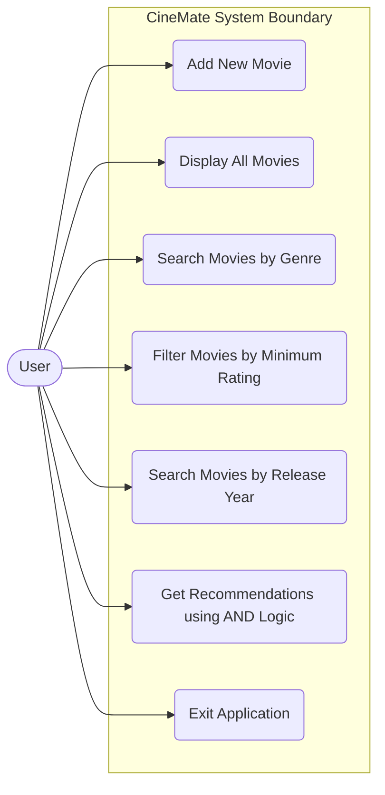

# CineMate - Use Case Diagram

The following diagram illustrates the functional interactions between the **User** actor and the **CineMate (Movie Recommendation System)**.

---

## Detailed Use Case Summaries

| Use Case ID | Use Case Name | Description |
| :--- | :--- | :--- |
| **UC-1** | Add New Movie | User inputs movie details (title, genre/category, rating, year, subgenre/humor style). System validates inputs and checks duplicate rules before storing. |
| **UC-2** | Display All Movies | User views a complete listing of all sample and custom movies stored in the system. |
| **UC-3** | Search Movies by Genre | User enters a genre keyword; system performs case-insensitive filtering and displays matches. |
| **UC-4** | Filter Movies by Rating | User enters a rating threshold; system displays all movies with $Rating \ge \text{threshold}$. |
| **UC-5** | Search Movies by Release Year | User selects exact year or year range search to discover matching movies. |
| **UC-6** | Get Recommendations | User combines genre, minimum rating, and optional year range using AND logic to receive customized recommendations. |
| **UC-7** | Exit Application | User exits the console application cleanly. |
